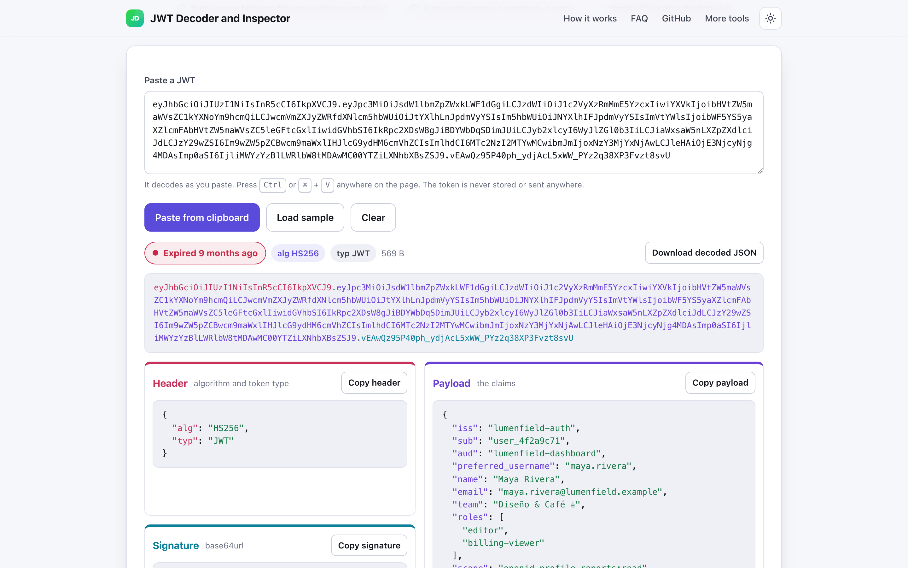
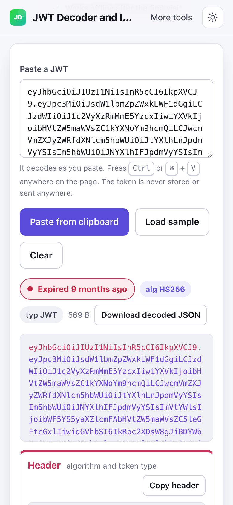

# JWT Decoder and Inspector

> Decode a JWT and read its claims and expiry in your browser, the token never leaves the page.

**🌐 Use it now: [turhe123.github.io/jwt-decoder-local](https://turhe123.github.io/jwt-decoder-local/)** · free · open source · runs in your browser · works offline


## Why

Most people decode a JSON Web Token by pasting it into a website, and a live token can be used to impersonate a user, so it is fair to worry about where it goes. This is a free, open-source alternative to jwt.io that keeps everything on your device: the token never leaves the page, there is no account, no ads and no limits, it works offline, and you can install it as an app.

## Screenshots

<p align="center"></p>

<p align="center"><em>JWT Decoder and Inspector in the browser, light theme</em></p>

<p align="center"></p>

<p align="center"><em>JWT Decoder and Inspector on a phone</em></p>

## Features

- One box for the token. It decodes as you paste, and cleans up a `Bearer` prefix, an `Authorization:` label, surrounding quotes, line breaks and spaces. Missing base64url padding is fine.
- Header, payload and signature shown in three matching colors, both in the encoded token and as separate cards. Header and payload are pretty-printed, syntax-highlighted JSON. Non-ASCII claim values display correctly.
- Claims table that explains registered and common claims (`iss`, `sub`, `aud`, `exp`, `nbf`, `iat`, `jti`, `scope`, `roles`, `email` and more) in plain words. Unknown claims are marked as custom.
- Timestamps (`exp`, `nbf`, `iat`, `auth_time`, `updated_at`) shown in local time and UTC, with a relative description and the raw number.
- Live status chip: not valid yet, valid (with a countdown) or expired. A note explains clock skew.
- Optional, collapsed verify panel. The secret or key stays on the device, is used through the browser's WebCrypto, and is not saved.
- Warnings for `alg: none`, a missing signature, a missing `exp`, an unknown algorithm, date claims that look like milliseconds, and date claims that are not numbers.
- Encrypted tokens (five parts, JWE) are recognised; only the header can be shown.
- Clear errors that name the broken part, for example "Payload (part 2) is not valid base64url" or "Header (part 1) decodes, but is not valid JSON".
- Copy buttons for the header, payload and signature, and a button to download the decoded token as a JSON file.
- Load sample button with a fictional token and its demo secret, `demo-secret-not-real`.
- Paste from clipboard button, plus Ctrl or Cmd + V anywhere on the page.
- Light and dark themes, usable at 390px wide, installable as a PWA.

**Input:** a JWT as text (three parts, or two for an unsecured token; a five-part JWE is shown partly).

**Signature verification:**

| Algorithms | Key you provide |
| --- | --- |
| HS256, HS384, HS512 | Shared secret as typed, a base64url secret, or a JWK with `"kty": "oct"` |
| RS256, RS384, RS512, PS256, PS384, PS512 | Public key as PEM (`PUBLIC KEY`, `RSA PUBLIC KEY` or `CERTIFICATE`), a JWK or a JWKS |
| ES256, ES384, ES512 | Public key as PEM, a JWK or a JWKS |

For a JWKS, the key whose `kid` matches the token header is used.

**Output:** the page itself, copied text, and a downloadable `jwt-decoded*.json` containing the header, payload and signature.

**Limits:**

- Tokens are only decoded and verified, never created.
- Verification needs WebCrypto, which browsers only enable on secure pages (https or localhost). Decoding works without it.
- Expiry status uses your device clock.
- Encrypted (JWE) token contents cannot be read.
- Decoding is not proof that a token is genuine; only a signature check is.

## How to use

1. Open the page and paste your token into the box, press Ctrl or Cmd + V, or click **Load sample**.
2. Read the header, payload, status chip and the claims table. Dates are shown in local time and UTC.
3. To check the signature, open **Verify the signature**, paste the shared secret or the public key (PEM or JWK), and click **Verify signature**.
4. Copy any part, or download the decoded JSON.

## Privacy

- Nothing is uploaded. The token and any secret or key are processed in your browser and are never written to local or session storage.
- No cookies.
- Page views are counted anonymously with [GoatCounter](https://www.goatcounter.com/), which is cookieless and open source.
- Works offline after the first visit, thanks to a service worker.

## Run it locally

```sh
git clone https://github.com/turhe123/jwt-decoder-local
cd jwt-decoder-local
python3 -m http.server 4173
```

Then open http://127.0.0.1:4173/. There is no build step.

## Tests

```sh
npm i -D @playwright/test && npx playwright install chromium
npx playwright test
```

## Third-party code

None: browser APIs only.

## Built with AI

JWT Decoder and Inspector was written by [Claude Code](https://claude.com/claude-code) inside an automated pipeline, from a plain-English spec. No code or assets from any commercial product were used; it is a clean-room implementation of a feature set, not a copy.

What that means in practice:

- The full source is in this repo under the MIT license. Read it before you trust it with your files.
- Everything runs in your browser. It makes no network requests except an anonymous, cookieless page-view count (GoatCounter); your files never leave the device.
- The page is tested headless in Chromium (Playwright) before every release, but it has had less human review than hand-written software. Bug reports and pull requests are welcome.

## Support ❤️

If this saves you time, you can [support the work on Ko-fi](https://ko-fi.com/leodavidai).

## More free web tools

Find more at [turhe123.github.io/web-tools](https://turhe123.github.io/web-tools/).

## License

MIT © Or Davidai Bachar
